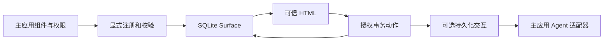

# RailsToolViews 一眼看懂

把已有 Rails Partial/ViewComponent 注册为可信、可持久化、可交互的展示能力。普通 Rails 代码可以使用；RubyLLM 是可选适配器。v0 的 ChoiceCard 继续可用；v1 增加客户表单、客服工单和版本化结果审阅，业务记录与权限仍由主应用决定。demo还有Agent chat：真实RubyLLM聊天循环通过present_ui呈现可信组件，用户选择作为新的user turn续接（离线运行，无需API key）。

已实现：Registry/schema、Surface/恢复、授权动作与幂等、JSON/Turbo、可选工具和后续交互、安装器、表单错误反馈与三个 v1 演示。客户创建、工单分配、结果接受/导出是确定性的主应用服务；回复草拟与再生成通过明确续接触发。演示使用离线夹具，回复只入本地 outbox。1.0.0 已以 MIT 发布到 RubyGems，文档站 https://rails-tool-views.wangyaodi.com 由 GitHub Pages 托管；稳定与 next 文档分开，发布由经过验证的 Git 标签通过 OIDC 触发。

先看 README 的离线演示；再看 01_PROJECT_STATUS 和 03_SYSTEM_ARCHITECTURE。0.2 发布的本地与远端 Ruby/Rails/PostgreSQL 兼容性已核验；最大的未证实部分是独立安全审核、MySQL/真实 provider 行为与外部接入价值。

0.2 的安全生成器/完整 HTML 纠错延续到0.3。0.3已发布 close/abandon 与默认关闭的 payload 清理：明确完成/放弃、保留期限，先 scoped preview，再 apply，保留关联 tombstone 和业务记录。不确定投递不能按时间强删。需要迁移并停止旧 writers。精确标签远端 matrix/upgrade/安装/浏览器/审计和稳定0.3/next已验证，详见[发布记录](../evidence/RELEASE_0_3_0.md)。`bin/check --browser` 是本地验证入口。

0.4已完成公开交付：既有attempts为投递确认加fence，host job验证中断恢复；action.executed新增replayed，notice只显示一次响应并保留旧message语义。无新schema/依赖/内置队列。完整本地验收见V0_4_VALIDATION，精确远端CI、公开包/隔离安装和稳定0.4/next验收见[发布证据](../evidence/RELEASE_0_4_0.md)。

1.0.0已公开发布（2026-10-26）：声明公共契约、reconcile_delivery、purge_closed游标分页、无adapter投递报AGENT_NOT_CONFIGURED。owner跳过rc1并豁免条件5/6的外部试用与独立审核（DELTA-008）。稳定1.0在`/`，0.4在`/v0/`，见[发布证据](../evidence/RELEASE_1_0_0.md)。不自动推进新版本。
