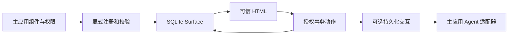

# RailsToolViews 一眼看懂

把已有 Rails Partial/ViewComponent 注册为可信、可持久化、可交互的展示能力。普通 Rails 代码可以使用；RubyLLM 是可选适配器。v0 的 ChoiceCard 继续可用；v1 增加客户表单、客服工单和版本化结果审阅，业务记录与权限仍由主应用决定。

已实现：Registry/schema、Surface/恢复、授权动作与幂等、JSON/Turbo、可选工具和后续交互、安装器、表单错误反馈与三个 v1 演示。客户创建、工单分配、结果接受/导出是确定性的主应用服务；回复草拟与再生成通过明确续接触发。演示使用离线夹具，回复只入本地 outbox。0.1.0 已以 MIT 发布到 RubyGems，文档站 https://rails-tool-views.wangyaodi.com 由 GitHub Pages 托管；稳定与 next 文档分开，发布由经过验证的 Git 标签通过 OIDC 触发。

先看 README 的离线演示；再看 01_PROJECT_STATUS 和 03_SYSTEM_ARCHITECTURE。0.1 发布的本地与远端 Ruby/Rails/PostgreSQL 兼容性已核验；最大的未证实部分是独立安全审核、MySQL/真实 provider 行为与外部接入价值。

0.2 的安全 Partial 生成器与完整 HTML 纠错已本地完成，测试入口是 `bin/check` 和 `bin/check-browser`；后者真实运行 Chrome 并保存截图。实际 gem 接入由临时隔离 host 验证。当前没有推送或发布 0.2，远端 CI 等下一步授权；详见 [验证记录](../evidence/V0_2_VALIDATION.md)。
