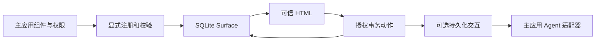

# ToolViews 一眼看懂

把已有 Rails Partial/ViewComponent 注册为可信、可持久化、可交互的展示能力。普通 Rails 代码可以使用；RubyLLM 是可选适配器。v0 只做 ChoiceCard，状态保存与动作授权由 Rails 决定。

已实现：Registry/schema、Surface/恢复、授权动作与幂等、JSON/Turbo、可选工具和后续交互、安装器与演示。当前为本地验证完成的未发布草稿。

先看 README 的离线演示；再看 01_PROJECT_STATUS 和 03_SYSTEM_ARCHITECTURE。最大的未证实部分是发布兼容性、独立安全审核与实际接入价值。
