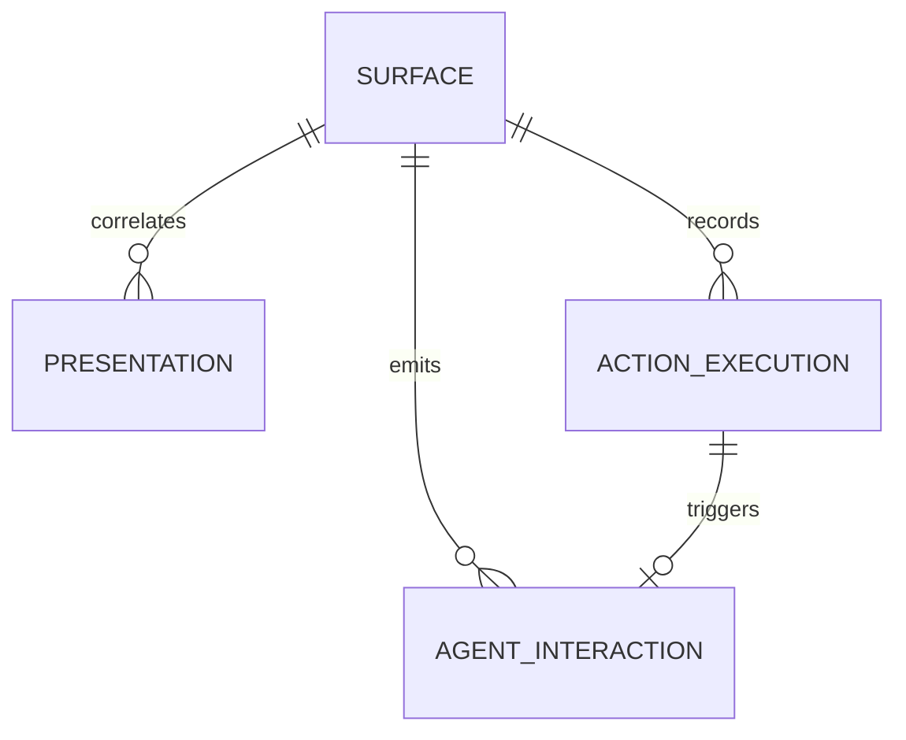
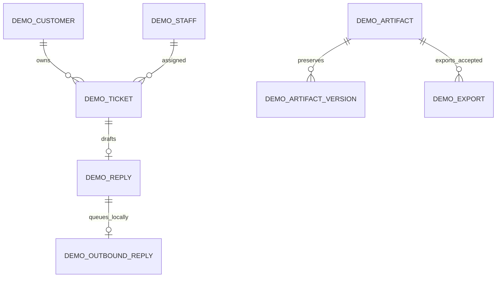

# 当前架构

Registry 是 Ruby 定义：可信 renderer、严格 schema、版本摘要、权限和动作 allowlist。Core 入口不加载 RubyLLM；唯一 SDK require 在可选适配器文件。

Surface 保存 actor/tenant 不透明标识、context 引用、组件摘要、props/state、revision/lock_version。Presentation 的 actor+tenant+adapter+call+context 唯一键去重工具请求。ActionExecution 的 Surface+key 唯一键保存回执；参数摘要识别错误复用。AgentInteraction 的 execution 唯一键保存结构化输入、投递状态与 lease。

动作先校验/授权，再在同一数据库事务里执行 host handler、更新 revision 并写回执。JSON/Turbo 在提交后选择输出。Agent 投递在事务外；失败不会回滚已经保存的选项。跨数据库或外部服务副作用不在此原子性保证里。

默认拒绝读取/展示/动作；Surface 的 actor+tenant 必须匹配，并再次调用 host policy。source/target 绑定当前 Surface。模型 props 和客户端 policy 文本不能决定业务权限。host 自行解决数据库备份、保留期、敏感数据投影、远端去重与队列。

v1 的业务权威在参考 host 的九张表：DemoStaff、DemoCustomer、DemoTicket、DemoReply、DemoOutboundReply、DemoArtifact、DemoArtifactVersion、DemoExport、DemoAgentReceipt。gem 包不带这些模型/迁移。TicketCard/ResultReview 的 props 只保存记录 ID；resolver 每次检查当前租户和关联，业务 lock_version/current_version 独立于 Surface revision。

SurfacesController 继承主应用 ApplicationController，因此挂载请求保留认证过滤器、scope 方法与视图 helper。主应用必须使用 HTML-capable controller 并审阅继承的过滤器。演示身份切换只选择固定测试角色，不能复用为生产认证。

ValidationError 是受限的展示反馈，包含字段错误和批准的提交值；拒绝动作不持久化这些值，也不提交业务写入或回执。授权 HTML/Turbo 重绘当前组件，JSON 返回 422。业务续接在提交后执行；示例 Agent 将新业务版本/回复与 DemoAgentReceipt 放在一个事务，使用持久化 delivery_key 处理已写入但未确认的重试。外部 provider 仍需要自身 durable deduplication。
