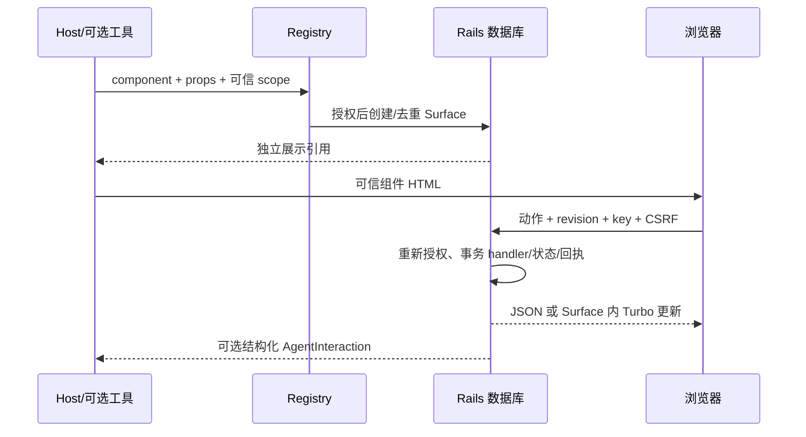

# 运行流程

刷新只读取持久化数据，不调用模型。重复 key 返回已有回执；不同参数复用 key 被拒；过期 revision 返回冲突并显示当前状态。权限失败不泄漏 props。组件摘要变化显示兼容性错误而保留数据。

后续交互可同步投递，也可由 host 关闭 auto_deliver 后在 Active Job 调用 deliver。pending/failed/completed 与选项保存分开。失败可明确重试；重试前再次授权，使用同一 delivery key。RubyLLM continuation 使用新的 user turn，拒绝混入未完成 tool round。

客户表单：批准的 draft props → 人工修正 → 严格字段 schema → host 校验。错误反馈 422 并保留批准输入，Surface revision 不变；有效提交在同事务创建 Customer、记录 customer_id 和幂等回执。第二次不同 key 也不能重复提交已完成的表单。

工单：可信 staff scope → 有界 query → 返回安全 ID/subject/status → renderer 重新解析关联。查看/分配是确定性动作；草拟只产生显式 interaction，离线 host Agent 写 draft。人工编辑/批准后，lead 勾选确认才能写本地 outbox；没有发送服务。另一个租户、已撤销角色、错误账户关联、伪造 source/action 都被拒绝。

结果：候选版本 → edit 新增不可变版本 → regenerate 明确 interaction → Agent 检查原始业务版本和接受状态再新增版本。Surface revision 与 artifact version 分开，另一 Surface 的过时请求也会冲突。失败续接保留人工修改；重启后可重试。accept 锁定当前版本；export 只对该接受版本生成主应用文本记录，下载再次授权。导出失败回滚并允许原 key 重试。进一步创作通过新 draft 开始。
