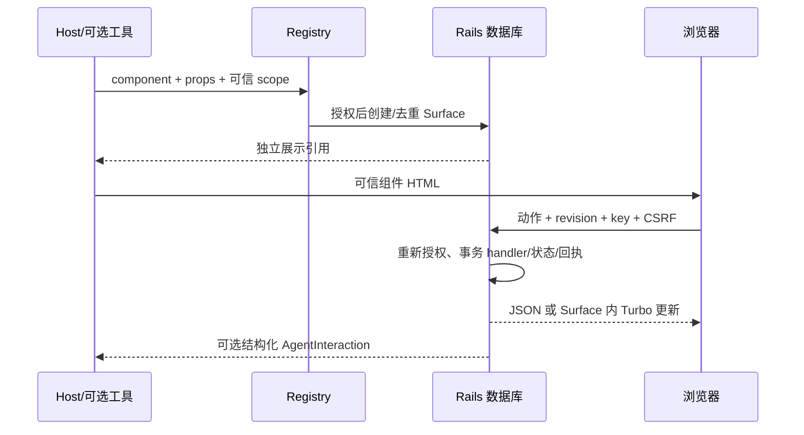

# 运行流程

刷新只读取持久化数据，不调用模型。重复 key 返回已有回执；不同参数复用 key 被拒；过期 revision 返回冲突并显示当前状态。权限失败不泄漏 props。组件摘要变化显示兼容性错误而保留数据。

后续交互可同步投递，也可由 host 关闭 auto_deliver 后在 Active Job 调用 deliver。pending/failed/completed 与选项保存分开。失败可明确重试；重试前再次授权，使用同一 delivery key。RubyLLM continuation 使用新的 user turn，拒绝混入未完成 tool round。
